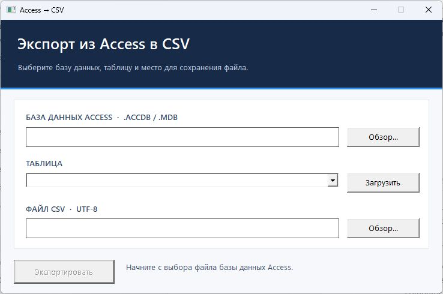

# Access CSV Exporter

This repository contains two small Windows examples for exporting a Microsoft Access table to CSV:

- **[AccessCsvExporter.Mfc](AccessCsvExporter.Mfc/AccessCsvExporter.Mfc.sln)** — a native C++/MFC desktop window. Choose an `.accdb` or `.mdb` file, load its tables, select one, choose an output path, and export it.
- **AccessCsvExporter** — the original C#/.NET 8 console version described below.

## C++/MFC desktop version



В окне можно выбрать базу Access, загрузить список таблиц и выгрузить выбранную таблицу в CSV. Исходники и проект Visual Studio находятся в папке `AccessCsvExporter.Mfc`.

Open `AccessCsvExporter.Mfc/AccessCsvExporter.Mfc.sln` in Visual Studio 2022. In Visual Studio Installer, select **Modify → Individual components → C++ MFC for latest v143 build tools (x86 & x64)**. Also install the MSVC v143 x64 tools and Windows SDK. Select **Release | x64** and **Build Solution**. Run `AccessCsvExporter.Mfc/build/Release/AccessCsvExporter.Mfc.exe`. A prebuilt x64 EXE is also available from the latest successful [GitHub Actions run](https://github.com/pepelaz1/access-csv-exporter/actions/workflows/mfc-windows.yml) under **Artifacts → AccessCsvExporter-MFC-x64**.

The 64-bit Microsoft Access ODBC driver (`Microsoft Access Driver (*.mdb, *.accdb)`) must be installed. The application reads table names through ODBC, streams rows into a UTF-8 CSV with a BOM, doubles embedded quotes, quotes fields containing commas or line breaks, and replaces the destination only after a complete export. Binary columns are explicitly rejected by this small demo. Access itself is not required, but the matching ODBC driver is.

The native CSV formatter and ODBC code can be compiled and smoke-tested without MFC using `AccessCsvExporter.Mfc/build-native-tests.cmd`. This checks Unicode CSV quoting and the missing-database error. The GitHub Actions build passes those checks and builds the MFC EXE. The EXE was also launched on Windows. Export against a real Access database has not yet been tested end to end.

## C#/.NET console version

A small C#/.NET 8 Windows console example that reads one table from a Microsoft Access `.accdb` or `.mdb` database and exports it to UTF-8 CSV. It validates that the table exists, streams rows instead of loading the whole database into memory, handles commas/quotes/newlines, and writes through a temporary file so an interrupted export does not replace an existing CSV.

## Requirements

- Windows and .NET 8 SDK.
- Microsoft Access Database Engine (ACE) installed with the same architecture as the running `dotnet` process. The program uses `Microsoft.ACE.OLEDB.12.0`. Microsoft 365 Access Runtime can provide the driver. Access itself is not required.

## Run

```powershell
dotnet run --project AccessCsvExporter -- "C:\data\orders.accdb" "Orders" "C:\data\orders.csv"
```

The output includes a header row and uses commas as the delimiter. Text is CSV-escaped; dates use ISO 8601, numbers use the invariant culture, binary fields use Base64, and nulls become empty fields. The CSV is UTF-8 with a BOM for Excel compatibility.

If the provider is missing or its 32/64-bit architecture does not match the process, `connection.Open()` fails. Install a matching ACE runtime, or run the matching x86/x64 .NET SDK. No database file is included in this repository because client data must not be published.

## Check CSV formatting

```powershell
dotnet run --project AccessCsvExporter.Tests
```

This smoke test uses an in-memory table to verify quoting, multiline fields, decimal formatting, and null handling. A real Access export additionally needs an `.accdb` or `.mdb` file and the ACE provider installed on Windows.

This is a focused sample of the data-export portion of a larger desktop application. It does not claim to rebuild or modify a particular customer's MFC program.
